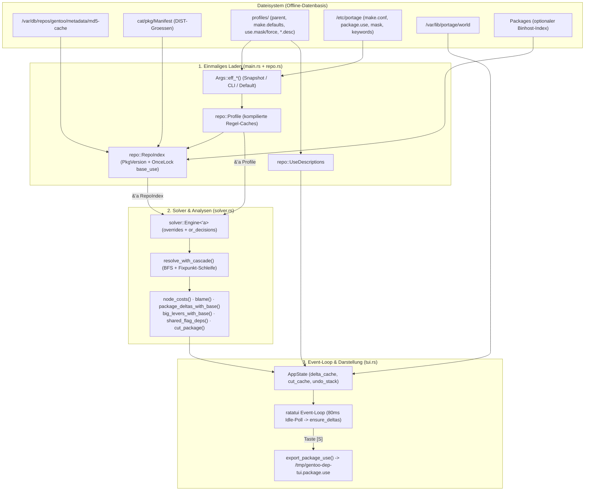
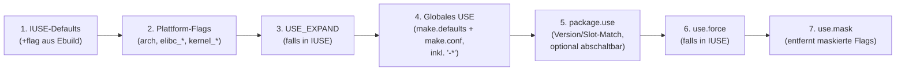
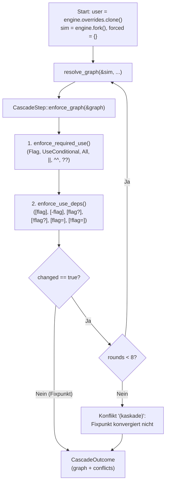

# Architektur & Implementierung von `gentoo-dep-tui`

Wenn man unter Gentoo ein einzelnes USE-Flag umlegt — etwa `-rdw` bei `sys-power/tlp` oder `-perl` bei `dev-vcs/git` —, löst das im Abhängigkeitsgraphen oft eine Kettenreaktion aus: Optionale Laufzeitpakete verschwinden, `REQUIRED_USE`-Regeln greifen ein, andere Pakete erzwingen Flags über `[flag?]`- oder `[flag=]`-Kanten zurück, oder das scheinbar teure Paket bleibt einfach liegen, weil vier andere Pakete es ebenfalls festhalten.

`emerge -pv` beantwortet das zwar exakt, braucht aber für jedes „Was-wäre-wenn?“-Experiment mehrere Sekunden und bietet keine interaktive Kostenübersicht. **`gentoo-dep-tui`** überträgt die Idee von `ncdu` auf den Gentoo-Abhängigkeitsgraphen: Es liest die bereits vorhandenen Metadaten des Portage-Baums (`metadata/md5-cache`, `Manifest`, Profile und optional eine Binhost-`Packages`-Datei) direkt in den Speicher ein und simuliert Dutzende Gegenszenarien parallel in Millisekunden.

> **Hinweis zur Code-Basis:** Diese Beschreibung stützt sich exakt auf die vorliegende, fokussierte TUI-Codebasis (`Cargo.toml` sowie `src/main.rs`, `src/repo.rs`, `src/solver.rs`, `src/tui.rs`) und vollzieht die Konzepte anhand der gezeigten realen Terminal-Mitschnitte (`sys-power/tlp`, `dev-vcs/git`, `app-crypt/gpgme`) nach.

---

## 1. Das Grundprinzip: Wie simuliert man 60 Gegenszenarien in Millisekunden?

Bevor wir in die Module abtauchen, lohnt ein Blick auf die zentrale Entwurfsentscheidung, die das gesamte Programm prägt:

**Teure Welt einmal unveränderlich aufbauen – billige Abweichungen forken.**

Würde man für jedes USE-Flag eines Pakets die Profile neu einlesen, `Manifest`-Dateien parsen oder gar den gesamten Paketindex klonen, wäre jede Cursor-Bewegung zäh. Stattdessen trennt `gentoo-dep-tui` strikt zwischen:

1. **Unveränderlicher Basis (`RepoIndex` & `Profile`)**: Wird beim Start einmalig parallel geladen und lebt danach schreibgeschützt (`&RepoIndex`, `&Profile`). Selbst die Profil-Default-USE-Flags jedes Pakets werden erst bei Bedarf und genau **einmal** pro Paket über ein `OnceLock` berechnet.
2. **Winzigem Simulationszustand (`Engine<'a>`)**: Enthält neben den Referenzen auf Index und Profil nur zwei kleine Maps: `overrides` (welche Flags der Nutzer oder die Kaskade geändert haben) und `or_decisions` (gewählte `||`-Alternativen). Ein `engine.fork()` kopiert also nur eine Handvoll Strings — nicht ~14.000 Pakete.
3. **Statischem Pruning + `rayon`-Parallelität**: Bevor eine USE-Flag-Simulation überhaupt gestartet wird, prüft der Solver statisch, ob das Flag im `RDEPEND`, `PDEPEND`, `SRC_URI`, `REQUIRED_USE` oder in eingehenden USE-Dependencies überhaupt vorkommt. Wenn nein, ist das Delta garantiert `0 B` — ohne einzige Graph-Traversierung.

---

## 2. Makro-Architektur: Vier Module, ein Datenfluss

Die Anwendung besteht aus rund 1.900 Zeilen Rust (Edition 2024) in vier klar getrennten Modulen:



Die Modul-Verantwortlichkeiten im Überblick:

| Modul | Aufgabe | Zustand |
| :--- | :--- | :--- |
| **`src/main.rs`** | CLI-Parsing (`clap`), Auflösung der Pfad-Prioritäten (`--make-conf` > `--snapshot` > `--portage-dir`), Bootstrapping | Ephemer |
| **`src/repo.rs`** | Profil-Vererbung, Konfig-Parser (`make.conf`, `package.*`), paralleles Einlesen von `md5-cache`, `Manifest`, `Packages` und `*.desc` | **Unveränderlich** nach Start |
| **`src/solver.rs`** | Laufzeit- und Buildzeit-Resolver, `REQUIRED_USE`/USE-Dep-Kaskade, Konflikterkennung, Blame, Exklusivkosten, Deltas, Big Levers, Cut-Analyse | Funktional / kurzlebig (`Engine::fork`) |
| **`src/tui.rs`** | Dreispaltige `ratatui`-Oberfläche, Tab 2 (`Big Levers`), Undo-Stack, Lazy/Idle-Nachladen, Quick-Switch-Modals, `package.use`-Export | Interaktiv (`AppState`) |

---

## 3. Schicht 1: Die Gentoo-Welt einlesen (`main.rs` & `repo.rs`)

### 3.1 Konfigurations-Prioritäten in `src/main.rs`
Damit das Tool sowohl auf einem Live-System als auch in einem isolierten Snapshot-Verzeichnis (z. B. einem Docker-Container) funktioniert, kapselt `Args` die Pfadauflösung in `eff_repo()`, `eff_world()`, `eff_portage_dir()`, `eff_make_conf()` und `eff_package_use()`. Die Rangfolge ist konsistent:
1. Explizites Datei-Flag (z. B. `--make-conf`),
2. Snapshot-Unterpfade (`<snapshot>/make.conf` oder `<snapshot>/etc/portage/make.conf`),
3. Standard-Portage-Verzeichnis (`/etc/portage` bzw. `<snapshot>/etc/portage`).

### 3.2 Profil-Vererbung als DAG-Linearisierung (`load_profile_stack`)
Gentoo-Profile sind kein einzelner Ordner, sondern ein gerichteter azyklischer Graph (DAG) aus `parent`-Dateien, der Mehrfachvererbung erlaubt (z. B. `default/linux/amd64/23.0` erbt von `base`, `arch/amd64`, `releases/23.0` usw.).

`load_profile_stack` löst zunächst einen eventuellen Symlink `<portage-dir>/make.profile` relativ zu `<repo>/profiles` auf (`resolve_make_profile`) und traversiert dann den `parent`-Graphen mit einer **iterativen Post-Order-Tiefensuche**:
- Jeder Knoten wird erst mit `expanded = false` auf den Stack gelegt.
- Beim Abnehmen schiebt er `(dir, true)` wieder auf den Stack und danach seine `parent`-Verzeichnisse in umgekehrter Reihenfolge (`rev()`).
- Ein `visited`-Set verhindert doppelte Besuche (Diamond-Vererbung), ein Tiefenlimit von 256 schützt vor Zyklen.

So entsteht in `chain` die korrekte **Basis-nach-Kind-Reihenfolge**. Über diese Kette werden nacheinander aufsummiert:
- `use.mask` & `use.force` (`apply_flag_list`, inkl. `-flag` zum Aufheben geerbter Masken),
- `package.mask` (Profil + `/etc/portage/package.mask` + `/etc/portage/package.unmask` als `-atom`),
- `make.defaults`: `ARCH`, `ACCEPT_KEYWORDS`, `ELIBC`, `KERNEL`, `USE` (inkl. `${USE}`-Ersetzung mit sortiertem Zwischenstand), `USE_EXPAND` und `USE_EXPAND_HIDDEN`.
- In einem zweiten Durchlauf über `chain` werden alle gesammelten `USE_EXPAND`-Variablen (wie `PYTHON_TARGETS`, `VIDEO_CARDS`) in `expand_defaults` eingesammelt.

Anschließend überlagert `load_profile()` diese Profilbasis mit `make.conf` (der Parser `logical_lines` beherrscht mehrzeilige Anführungszeichen, Backslash-Fortsetzungen `\` und quote-bewusstes `#`-Kommentar-Stripping via `strip_comment`), `package.use` und `package.accept_keywords` (jeweils als einzelne Datei oder sortiertes Verzeichnis).

### 3.3 Regel-Indizierung & effektive USE-Flags (`compile_pattern_caches` & `effective_defaults`)
Statt bei jedem Paket linear durch alle Zeilen von `package.use`, `package.mask` und `package.accept_keywords` zu iterieren, kompiliert `compile_pattern_caches` jede Zeile mit `portage_atom::Dep::parse` vor und legt sie **indiziert nach `cpn`** (`category/package`) in HashMaps ab (bei `package_mask_index` bleibt die globale Reihenfolge für Mask/Unmask erhalten).

Die Auswertungsreihenfolge für ein konkretes Paket in `Profile::effective_defaults_inner` spiegelt exakt die Portage-Semantik wider:



Der boolesche Parameter `include_package_use` im Schritt 5 ist ein wichtiges Detail: Für die Simulation (`effective_defaults`) ist er `true`, sodass alle bestehenden Einträge aus `/etc/portage/package.use` berücksichtigt werden. Beim **Export** (`export_package_use` in `tui.rs`) ruft das Programm hingegen `effective_defaults_without_package_use()` auf — dazu mehr in Kapitel 6.

### 3.4 Paralleles Laden von `RepoIndex::load`
Ein vollständiger Gentoo-Tree besitzt über 30.000 `md5-cache`-Dateien. `RepoIndex::load` macht das Laden durch drei Maßnahmen schnell:
1. **Deduplizierte `Manifest`-Vorladung (`preload_manifests`)**: Ein Paket hat oft mehrere Versionen im `md5-cache`, teilt sich aber genau **eine** `Manifest`-Datei im Paketverzeichnis (`cat/pkg/Manifest`). `preload_manifests` sammelt alle `(cat/pkg, dir)`-Paare, dedupliziert sie und parst alle `DIST`-Größen parallel via `rayon`.
2. **Paralleles Cache-Parsing (`files.par_iter()`)**: `split_pf` trennt Dateinamen wie `git-2.49.0-r1` von rechts am ersten `-<Ziffer>` in Paketname und Version. `portage_metadata::CacheEntry::parse` dekodiert `RDEPEND`, `PDEPEND`, `DEPEND`, `BDEPEND`, `IDEPEND`, `IUSE`, `REQUIRED_USE`, `SRC_URI`, `SLOT`, `KEYWORDS`.
3. **Frühes Filtern & Abwärts-Sortierung**: Live-Ebuilds (`9999` oder `is_live()`), durch `package.mask`/`unmask` maskierte Versionen (`is_masked`) und nicht durch `ACCEPT_KEYWORDS` / `package.accept_keywords` abgedeckte Versionen (`keywords_accepted`) landen gar nicht erst im Index. Alle verbleibenden Versionen je `cpn` werden absteigend nach `Version` sortiert, sodass `select(cpn)` in $O(1)$ die neueste akzeptierte Version liefert.

Auf jedem `PkgVersion` sitzt zudem `base_use: OnceLock<HashSet<String>>`. Da während der Flag-Delta- und Big-Lever-Analysen Tausende Male nach den Standard-Flags eines Pakets gefragt wird, berechnet `Engine::effective_use()` diese Basis genau beim allerersten Zugriff einmalig und addiert danach nur noch `self.overrides.get(&pkg.cpn)`.

---

## 4. Schicht 2: Das Solver-Herz (`src/solver.rs`)

### 4.1 Zwei Phasen der Graph-Auflösung: `resolve_graph`
Die Funktion `resolve_graph(engine, world, include_build, collect_blame)` baut den Laufzeit-Abhängigkeitsgraphen mittels Breitensuche (`VecDeque`) auf:

1. **Startpunkte**: Alle Atome aus `world` (ohne Blocker wie `!foo/bar`), für die `index.select_for_dep(&dep)` ein passendes `PkgVersion` findet.
2. **Knoten-Expansion**: Für jedes Paket in der Queue holt `resolve_target` die passende Version (bei Versionsbeschränkung über `select_for_dep`, sonst die neueste über `select`), bestimmt die aktiven Flags (`engine.effective_use(pkg)`) und berechnet die eigene Download-Größe `download_bytes` — dabei filtert `collect_dist_files` die `SRC_URI`-Einträge anhand der aktiven USE-Flags (so steigen oder fallen die `dl`-Bytes je nach bedingten Tarballs).
3. **Abhängigkeits-Auswertung**: `DepEntry::evaluate_use` faltet `RDEPEND` und `PDEPEND` gegen die aktiven Flags aus. `descend_runtime` verarbeitet:
   - `Atom`: fügt eine Vorwärtskante in `graph.out_edges` hinzu und (wenn `collect_blame == true`) eine Rückwärtskante in `graph.reverse` samt `via_flag`.
   - `AnyOf` (`|| ( a b )`): `descend_any_of` baut eine stabile `group_id` (`"{owner}||{candidates}"`), wählt den Index aus `engine.or_decisions` (Standard `0`, also erster erfüllbarer Kandidat) und registriert eine `AlternativeChoice`, die links in der TUI als `|| ...`-Eintrag interaktiv durchgeschaltet werden kann.
   - `ExactlyOneOf` / `AtMostOneOf`: wählt über `pick_first` den ersten verfügbaren Kandidaten.

#### Warum `via_flag` über `collect_via_flags` so wichtig ist
Bevor `evaluate_use` die Bedingungen wegfaltet, merkt sich `collect_via_flags` (falls `collect_blame == true`), **unter welcher USE-Bedingung** ein Kindpaket erreicht wurde (z. B. `ppd`, `rdw` oder negiert `!static`). Bei verschachtelten Bedingungen gewinnt die tiefste aktive Bedingung; liegt das Paket gleichzeitig unbedingt vor (`cond == None`), wird der Eintrag mit `(0, None)` überschrieben. Dieses scheinbar kleine Detail ermöglicht später sowohl die Blame-Erklärung als auch die gesamte Cut-Analyse!

#### Runtime vs. Build-Only (`resolve_build_extra`)
Im realen Mitschnitt sieht man in der Fußzeile:
```text
Binpkg 756.6 MB (503/554 Hits)  Quell-DL 3313.0 MB  Build-Only 243.2 MB bin / 1761.3 MB dl  Pakete 554
```
Wenn `include_build == true` (beim normalen TUI-Refresh, **nicht** bei den schnellen Flag-Simulationen), sammelt `resolve_build_extra` alle `DEPEND`, `BDEPEND` und `IDEPEND` der Laufzeitknoten sowie deren eigene Laufzeit-Hülle (`RDEPEND`/`PDEPEND`) — filtert aber jedes Paket heraus, das schon in `graph.nodes` liegt. So sieht man die reinen Build-Werkzeuge (Compiler, `cmake`, `meson`, Header-Pakete) getrennt, ohne dass sie die Runtime-Größe verwässern.

### 4.2 Die Kaskaden-Fixpunktschleife (`resolve_with_cascade` & `CascadeStep`)
Ein reines Durchlaufen von `RDEPEND` reicht bei Gentoo nicht, weil USE-Flags über Paketgrenzen hinweg gekoppelt sind. Schaltet man bei Paket A ein Flag an, kann das:
1. in Paket A selbst ein weiteres Flag per `REQUIRED_USE` erzwingen (`a? ( b )`), oder
2. bei Abhängigkeit B per USE-Dep ein Flag verlangen (`dev-libs/foo[bar]` oder `[bar?]`, `[bar=]`).
3. Dadurch verändert B seine eigenen `RDEPEND`s und zieht vielleicht Paket C nach — das wiederum eigene `REQUIRED_USE`- und USE-Dep-Forderungen hat!

Genau deshalb umwickelt `resolve_with_cascade` den Graph-Aufbau mit einer **Fixpunkt-Schleife** (maximal `MAX_CASCADE_ROUNDS = 8` Runden):



Zwei Mechanismen in `CascadeStep` verhindern dabei, dass der Solver stumm gegen den Willen des Nutzers arbeitet oder sich festfährt:

1. **Respekt vor dem User-Intent (`user` vs. `forced`)**:
   `CascadeStep` hält die ursprüngliche `user`-Map getrennt von den während der Kaskade automatisch gesetzten Flags (`forced`).
   - Ist ein gefordertes Flag profil-maskiert (`use_mask`), profil-erzwungen (`use_force`) oder hat der Nutzer explizit das Gegenteil in `user` gesetzt, ändert `force_flag` es **nicht** stillschweigend, sondern erzeugt ein `ConflictInfo` samt konkretem `QuickSwitch` (z. B. *„Kaskade uebernehmen: X an“*).
   - Wurde das Flag bereits in derselben Kaskade durch ein *anderes* Paket in `forced` in die Gegenrichtung gedrückt, entsteht ebenfalls ein sauberer Konflikt zwischen beiden Elternpaketen.
   - Bei fehlendem Flag in `IUSE` prüft `force_target` die Portage-Defaults (`[flag(+)]` / `[flag(-)]` über `ud.default`); passt der Default nicht oder fehlt er, entsteht ebenfalls ein `ConflictInfo`.

2. **Rückwärts-Abgleich (`try_parent_flip`)**:
   Bei bedingten oder gekoppelten Abhängigkeiten (`[flag?]`, `[!flag?]`, `[flag=]`, `[!flag=]`) gibt es oft zwei Wege: Entweder passt man das Zielpaket an — oder man lockert das Flag beim *Elternpaket*, wenn das Zielpaket schon durch User-Intent oder einen früheren Zwang festliegt. `try_parent_flip` prüft genau diese Ausweichbewegung, bevor es einen Konflikt meldet.

Im zweiten Screenshot zu `sys-power/tlp` sieht man das direkt in Aktion:
```text
[x] ppd -800.0 kB bin / -2.2 MB dl (+0/-3 pkg)
[ ] python_single_target_python3_12 0 B bin / 0 B dl CONFLICT
[ ] python_single_target_python3_13 0 B bin / 0 B dl CONFLICT
[x] python_single_target_python3_14 0 B bin / 0 B dl
[x] rdw -10.8 MB bin / -17.6 MB dl (+0/-14 pkg)
```
Da `python_single_target_python3_14` eingeschaltet ist, würde ein Toggle auf `3_12` oder `3_13` die `REQUIRED_USE`-Gruppe `^^ ( python_single_target_python3_12 python_single_target_python3_13 python_single_target_python3_14 )` verletzen. Die Delta-Simulation erkennt das sofort, markiert die Zeilen rot mit `CONFLICT` und hält für `Space` im Quick-Switch-Modal die Option *„nur behalten: python_single_target_python3_12“* (`keep_only_options`) bereit.

---

## 5. Schicht 3: Die vier Analyse-Werkzeuge im Detail

### 5.1 Exklusive Knoten-Kosten (`ResolvedGraph::node_costs`) & Taste `o`
Wenn der Nutzer im Screenshot `o` drückt, springt `sys-power/tlp` mit `(19 pkg, 11.7 MB)` an die Spitze der linken Liste, obwohl `tlp` selbst nur ein kleines Shell-Skript-Paket ohne Binpkg ist (`0 B`). Warum steht dort `19 pkg, 11.7 MB`?

`node_costs()` beantwortet für **jeden** Knoten $u$ im Graphen die Frage: *„Welche Pakete verlören jede Verbindung zu `world`, wenn $u$ verschwände?“*

Technisch macht `node_costs()` das extrem allokationsarm:
- Alle Paketnamen werden einmal auf Indizes `0..n-1` abgebildet; `adj` speichert die ausgehenden Kanten als `Vec<Vec<usize>>`.
- Statt $n$-mal ein `HashSet` anzulegen, nutzt die Schleife ein einziges Array `seen: Vec<u32>` und zählt lediglich eine Generations-ID `gen_id += 1` hoch.
- Für jeden zu testenden Schnittknoten `cut` startet eine BFS von allen `world`-Indizes (`w != cut`) und markiert erreichbare Knoten mit `seen[v] = gen_id`.
- Alle Knoten $i$ mit `seen[i] != gen_id` sind **exklusiv** von `cut` abhängig (`exclusive_packages`, `exclusive_metrics`).

```mermaid
flowchart LR
    W1["world: sys-power/tlp"] -->|"rdw"| R1["net-libs/libmbim"]
    W1 -->|"rdw"| R2["net-libs/libqmi"]
    W1 -->|"ppd"| P1["dev-python/dbus-python"]
    W1 -->|"python"| PY["dev-lang/python"]
    W2["world: app-portage/gentoolkit"] --> PY

    style R1 fill:#243b2e,stroke:#4caf50
    style R2 fill:#243b2e,stroke:#4caf50
    style P1 fill:#243b2e,stroke:#4caf50
    style PY fill:#3b2d24,stroke:#ff9800
```



Im Beispiel oben bleiben bei einem Schnitt durch `sys-power/tlp` die grünen Pakete (`libmbim`, `libqmi`, `dbus-python`, … — zusammen 19 Pakete) unerreichbar und zählen zu `tlp`s Exklusivkosten. `dev-lang/python` (orange) bleibt über `gentoolkit` erreichbar und wird **nicht** mitgezählt.

Und was passiert, nachdem der Nutzer im dritten Screenshot `ppd`, `rdw` und `python_single_target_python3_14` bei `tlp` abgeschaltet hat? `tlp` fällt von `(19 pkg, 11.7 MB)` auf `(2 pkg, 120.0 kB)` ans Ende der sortierten Liste — die Gesamtmenge sinkt exakt um die vorhergesagten 17 Pakete (`554 -> 537`) und `11.6 MB` Binpkg (`756.6 MB -> 745.0 MB`).

### 5.2 Marginale Flag-Deltas (`package_deltas_with_base`) & `Big Levers`
Für das ausgewählte Paket sammelt `package_deltas_with_base` alle Flags aus `iuse_defaults` plus aktuell aktiven Flags und filtert maskierte, Plattform- (`amd64`, `elibc_glibc`, `kernel_linux`) sowie versteckte `USE_EXPAND`-Flags heraus. Danach wird für jedes Flag parallel (`into_par_iter`) `flag_delta` aufgerufen:

1. **Statischer Schnellschluss (`flag_can_affect_graph`)**: Kommt das Flag weder in `RDEPEND`, `PDEPEND`, `SRC_URI`, `REQUIRED_USE` noch in irgendeiner `use_deps`-Forderung anderer Pakete auf dieses Paket vor, gibt es sofort `0 B` ohne jede Simulation zurück.
2. **Counterfactual-Lauf**: Andernfalls forkt es `engine`, kippt `!is_on` in `sim.overrides`, ruft `resolve_with_cascade(&sim, world, false, false)` auf (ohne `build_extra` und ohne `collect_blame` — deutlich schneller!) und bildet die Differenz zu `before`:
   - `delta.binpkg_bytes` / `delta.download_bytes`
   - `added_packages` / `removed_packages` (`diff_packages`)
   - den ersten **neu** hinzugekommenen `ConflictInfo`, der in `before.conflicts` noch nicht existierte.

`big_levers_with_base` (Tab 2) wendet dasselbe Muster systemweit an: Es sammelt alle derzeit eingeschalteten, schaltbaren Flags über alle Knoten in `base.graph` und simuliert für jedes Flag parallel das **gleichzeitige Abschalten auf allen haltenden Paketen**. Sortiert wird bei vorhandenem Binhost primär nach `binpkg_bytes` (aufsteigend, also größte Ersparnis zuerst), sonst nach `net_pkg_delta`.

### 5.3 Warum steht dort `0 B`? Geteilte Abhängigkeiten (`shared_flag_deps`)
Schauen wir auf den fünften Screenshot des realen Mitschnitts (`dev-vcs/git`):
- `git` hat `perl` verloren (`-12 pkg`, `-810.0 kB`), `nls` und `webdav` sind aus, `git` ist nur noch `1 pkg, 9.8 MB` groß.
- Nun steht der Cursor auf `[x] gpg 0 B bin / 0 B dl`.
Warum bringt das Abschalten von `gpg` bei `git` nichts? Die Antwort liefert `shared_flag_deps(&engine, &graph, "dev-vcs/git", "gpg")` in der rechten Spalte:
1. `collect_conditional_targets` durchläuft `RDEPEND` und `PDEPEND` von `git` und sammelt alle Pakete ein, die *innerhalb* einer aktiven `gpg?`-Bedingung liegen (`app-alternatives/gpg`).
2. Für jedes dieser Zielpakete schlägt es in `graph.reverse` nach, welche **anderen** Elternpakete außer `dev-vcs/git` es ebenfalls im Graphen halten.

Das Resultat sieht man live rechts im Terminal:
```text
Geteilte Abhaengigkeiten:
> app-alternatives/gpg
gehalten von app-crypt/gnupg
gehalten von app-crypt/gpgme
gehalten von app-portage/gemato
gehalten von app-portage/getuto
```
*(Hinweis aus `tui.rs`: `top_lines` zeigt per `.take(4)` zunächst die ersten vier Halter an — daher taucht der fünfte Halter `sys-apps/portage` genau in dem Moment sichtbar in der Liste auf, als `app-crypt/gpgme` im letzten Screenshot entfernt wurde!)*

### 5.4 Die Cut-Analyse (`cut_package`): Rückwärts-Schnitt bis zu den Flag-Hebeln
Anstatt nun manuell jedes der vier haltenden Pakete in der linken Liste suchen zu müssen, springt man im Mitschnitt mit `Tab` in die rechte Pane und wandert mit `j`/`k` durch die `right_targets`. Auf jedem Knoten löst `tui.rs` automatisch `cut_package(&engine, &world, base, target)` aus.

Wie arbeitet `cut_package`? Das Herzstück ist die rekursive Aufwärtssuche `collect_blockers_up`:

```mermaid
flowchart BT
    Target["Ziel: app-crypt/gpgme"] -->|"unbedingte Kante"| P1["app-portage/portage-utils"]
    P1 -.->|"via '!static'\n(parse_breakable_flag -> +static)\nSTOPP dieser Ast!"| FB["FlagBlocker:\napp-portage/portage-utils [+static]"]
    Target -->|"falls unbedingter Pfad\nohne schaltbares Flag\nbis world liefe"| WB["world_blocker"]

    style FB fill:#1f3a2e,stroke:#4caf50
    style Target fill:#3b2323,stroke:#f44336
```



Schritt für Schritt:
1. `collect_blockers_up` läuft über `graph.reverse` rückwärts vom Zielpaket nach oben (mit `visited`-Schutz gegen Zyklen).
2. Steht an einer Rückwärtskante ein `via`-Flag, prüft `parse_breakable_flag`:
   - Bei `via == "gpg"` ist die Bedingung `gpg? (...)`, zum Brechen muss das Flag also **aus** (`want_on = false`).
   - Bei `via == "!static"` (wie bei `portage-utils -> gpgme`) ist die Bedingung `!static? ( app-crypt/gpgme )`; zum Brechen muss `static` also **an** (`want_on = true`).
   - Ist das Flag im `IUSE` des Elternpakets vorhanden und weder Plattform- noch maskiert/erzwungen/versteckt, wird es als `FlagBlocker` gesammelt — **und die Suche stoppt auf diesem Ast**, denn ein höheres Paket muss man gar nicht anfassen.
3. Erreicht ein Pfad ohne schaltbares `via`-Flag ein Paket aus `world`, landet dieses in `world_blockers` (ein „harter“ Blocker, der sich nicht per USE-Flag lösen lässt).
4. Zum Schluss testet `simulate_cut` zwei Gegenszenarien im echten Kaskaden-Solver:
   - `without_flag_blockers`: alle gefundenen `FlagBlocker` anwenden, `world` unverändert lassen.
   - `without_all_blockers`: `FlagBlocker` anwenden **und** `world_blockers` aus `world` streichen.

Genau das demonstriert der Mitschnitt eindrucksvoll beim Durchklicken der `gpg`-Halter:
- **`app-alternatives/gpg`** und **`app-crypt/gnupg`** erfordern gleich **7** Flag-Blocker (`gnupg [-alternatives]`, `gemato [-gpg]`, `portage-utils [+static]`, `git [-gpg]`, `portage [+build]`, `portage [-rsync-verify]`, `smartmontools [-update-drivedb]`) für `-5.7 MB bin / -18 pkg`.
- **`app-crypt/gpgme`** hingegen hängt an einem einzigen, lokalen Hebel: `app-portage/portage-utils [+static]` (`-500.0 kB bin / -1.4 MB dl, -1/+0 pkg`).
- Ein Druck auf **`a`** (`apply_cut_blockers`) übernimmt diesen Blocker in `engine.overrides`, stößt `refresh()` an — und `gpgme` verschwindet sofort (`Pakete 525 -> 524`).

---

## 6. Schicht 4: Die TUI & Latenz-Architektur (`src/tui.rs`)

### 6.1 Dreispaltige Zustandshaltung (`AppState`)
`AppState` verwaltet neben den Solver-Daten alle UI-Caches und Navigationsebenen:
- **Rechte Ziele (`right_targets`)**: `rebuild_right_targets()` sammelt beim Wechsel von Paket oder Flag alle interessanten Paketnamen aus der rechten Spalte ein (Eltern aus den ersten 4 Blame-Ketten, `added_packages`, `removed_packages`, sowie `shared_flag_deps` samt deren Haltern). Dadurch kann der Cursor in der rechten Pane direkt auf Paketen stehen und ohne Umweg eine Cut-Analyse anfordern.
- **Caches**: `delta_cache` (Schlüssel `(cpn, overrides_fingerprint(&engine))`) verhindert Neuberechnungen beim Hin- und Herspringen zwischen Paketen; `cut_cache` speichert berechnete `CutPlan`s innerhalb einer Konfiguration.
- **Lazy Tab 2**: `levers_dirty` bleibt `true`, solange man auf Tab 1 bleibt. Erst beim Wechsel auf Tab 2 (`set_tab(Tab::BigLevers)`) werden alle systemweiten Hebel berechnet.
- **Undo-Stack**: `undo_stack` merkt sich bis zu 32 frühere `UseOverrides`-Zustände; `u` stellt den vorherigen Stand in einem Schritt wieder her.

### 6.2 Wie Scrollen ohne Ruckeln gelingt: `select_left_fast` + 80-ms-Idle-Loop
Würde jedes `j` oder `PgDn` in der linken Paketliste sofort `package_deltas_with_base` (20–100 parallele Solver-Läufe) aufrufen, würde gedrückt gehaltenes Scrollen spürbar hängen. `tui.rs` entkoppelt deshalb **Cursor-Bewegung** und **Berechnung**:

```mermaid
sequenceDiagram
    participant User as Nutzer
    participant Loop as event_loop (80ms poll)
    participant State as AppState
    participant Solver as rayon + solver.rs

    User->>Loop: drückt j / k / PgDn
    Loop->>State: select_left_fast(next)
    alt Delta schon in delta_cache
        State-->>Loop: flag_deltas sofort befüllt
    else Cache-Miss
        State->>State: flag_deltas.clear(), deltas_loading = true
    end
    Loop->>User: render() sofort ("(rechne Deltas...)")

    Note over Loop: Nutzer scrollt weiter -> vorheriges Paket wird nie berechnet!

    Loop->>Loop: event::poll(80ms) -> Timeout (keine Taste)
    Loop->>State: ensure_deltas()
    State->>Solver: package_deltas_with_base() (oder load_cut_for_target)
    Solver-->>State: Vec<FlagDelta> -> in delta_cache
    Loop->>User: nächstes render() zeigt echte Deltas
```

Dasselbe Prinzip gilt für die rechte Pane (`cut_loading` beim Blättern durch `right_targets`) sowie für Live-Filter (`/`) und Sortierung (`o`): Weder Filtern noch Sortieren rufen `resolve_with_cascade` erneut auf — sie operieren rein auf den bereits im Speicher liegenden Listen und `node_costs`.

### 6.3 Minimaler, idiomatischer `package.use`-Export (`export_package_use`)
Drückt der Nutzer am Ende **`S`**, soll keine überladene Datei entstehen, in der Plattform-Flags (`amd64`, `elibc_glibc`), profil-erzwungene Flags oder unveränderte Defaults stehen. `export_package_use` löst das für jedes Paket in `engine.overrides` so:

1. Es berechnet `profile_only = profile.effective_defaults_without_package_use(&pkg.iuse_defaults)` — also den reinen Profilzustand *ohne* bestehende `package.use`-Einträge.
2. Es berechnet `final_active = engine.effective_use(pkg)` — also den Zielzustand inklusive bestehender `package.use`-Regeln **und** den interaktiven Änderungen aus `overrides`.
3. Für jedes Flag in `pkg.iuse_defaults` (sortiert) überspringt es maskierte, erzwungene, Plattform- und versteckte `USE_EXPAND`-Flags.
4. Nur wenn `final_active.contains(flag) != profile_only.contains(flag)`, landet `flag` bzw. `-flag` in der Ausgabezeile.

Das Ergebnis sieht man am Ende des Terminal-Mitschnitts nach den Änderungen an `sys-power/tlp`, `dev-vcs/git` und dem Cut-Apply auf `gpgme`:
```text
app-portage/portage-utils static
dev-vcs/git -nls -perl -python_single_target_python3_14 -webdav
sys-power/tlp -ppd -python_single_target_python3_14 -rdw
```
Drei saubere, direkt für `/etc/portage/package.use` verwendbare Zeilen — für exakt die drei Pakete, die angefasst wurden, bereinigt um alle vom Profil ohnehin vorgegebenen Flags.

---

## 7. Mentales Modell zum Mitnehmen

Wenn man die Architektur von `gentoo-dep-tui` auf fünf Sätze komprimiert:

1. **Basis einmal laden (`repo.rs`)**: Profile linearisieren, `Manifest`s pro Paketverzeichnis deduplizieren, `md5-cache` parallel parsen und Profil-Defaults per `OnceLock` träge pro Paket cachen.
2. **Simulationszustand winzig halten (`Engine`)**: Änderungen sind nur zwei kleine HashMaps (`overrides`, `or_decisions`), sodass `fork()` in Nanosekunden geht.
3. **Kaskaden bis zum Fixpunkt ausrollen (`CascadeStep`)**: `REQUIRED_USE` und USE-Deps in bis zu 8 Runden auflösen, User-Intent achten und Konflikte als klickbare `QuickSwitch`-Optionen anbieten.
4. **Teures weglassen oder entkoppeln (`solver.rs` + `tui.rs`)**: `flag_can_affect_graph` spart unnötige Läufe, Simulationen rechnen ohne `build_extra`/`blame`, `node_costs` nutzt einen allokationsfreien Generation-BFS-Sweep, und der 80-ms-Idle-Loop hält das Scrolling flüssig.
5. **Vom Symptom zur Ursache über `via_flag` (`shared_flag_deps` & `cut_package`)**: Rückwärtskanten mit USE-Bedingung verbinden „Warum ist das `0 B`?“ direkt mit „Welche Hebel schalten es wirklich ab?“.
